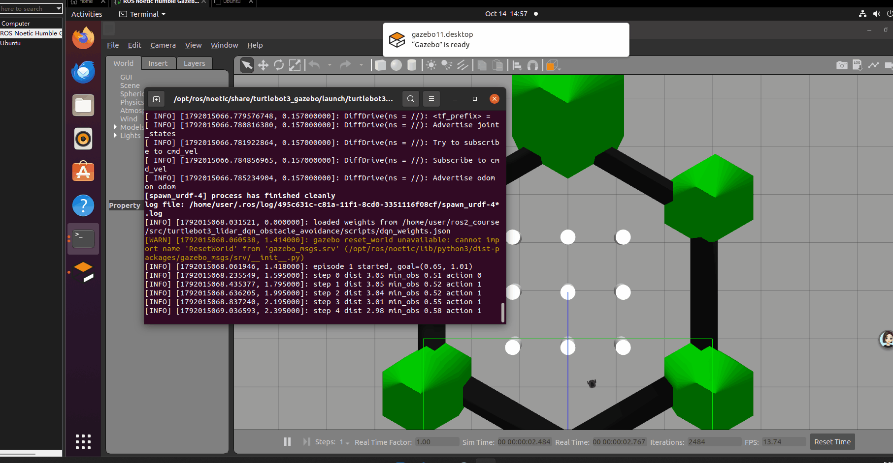

# 基于激光雷达与DQN的TurtleBot3避障控制

任务 2：传感器感知及运动控制。以激光雷达 `/scan` 为感知输入，DQN 神经网络输出离散运动指令到 `/cmd_vel`，在 Gazebo 仿真中实现自主避障与目标趋近。

## 运行环境
- Ubuntu 20.04、ROS Noetic、Gazebo 11（课程虚拟机），Python 3.8 + numpy，无需 torch/tensorflow。

## 感知与状态
360 度激光测距压缩为 24 个扇区，取每扇区最小距离并除以量程 2.0 归一化：
`s_i = min(ranges in sector_i) / 2.0, i = 0..23`

## 神经网络与算法
- Q 网络：三层 MLP，24-64-64-5，隐藏层 ReLU，输出层线性，Adam 优化。
- 经验回放容量 20000，批大小 32；目标网络每 50 步同步。
- Bellman 目标：`y = r + 0.95 * max_a Q_target(s', a)`，损失为均方误差。
- 探索：epsilon-greedy，每回合 eps 乘 0.995，下限 0.05。

## 奖励函数
`r = 0.05 * (2.0 - 目标距离) - 1.0 * [最小扇区 < 0.25m] - 0.2 * max(0, 0.4 - 前方距离) + 1.0 * [目标距离 < 0.6m]`

## 话题接口
| 话题 | 方向 | 类型 | 用途 |
|---|---|---|---|
| /scan | 订阅 | sensor_msgs/LaserScan | 激光雷达感知 |
| /odom | 订阅 | nav_msgs/Odometry | 位姿与目标距离 |
| /cmd_vel | 发布 | geometry_msgs/Twist | 运动控制输出 |

## 参数
| 名称 | 默认 | 含义 |
|---|---|---|
| mode | infer | train 训练并更新网络；infer 加载权重按贪心策略行驶 |
| episodes | 30 | mode=train 时的训练回合数 |

## 运行步骤
1. `source /opt/ros/noetic/setup.bash`
2. 训练：`roslaunch src/turtlebot3_lidar_dqn_obstacle_avoidance/launch/lidar_dqn_obstacle_avoidance.launch mode:=train episodes:=30`
3. 推理：`roslaunch src/turtlebot3_lidar_dqn_obstacle_avoidance/launch/lidar_dqn_obstacle_avoidance.launch`（默认 infer，自动加载 `scripts/dqn_weights.json`）
4. 也可直接运行入口：`python3 src/turtlebot3_lidar_dqn_obstacle_avoidance/scripts/main.py --mode train`

## 测试
不依赖 Gazebo 的本地单元测试：
`python3 -m unittest tests/test_lidar_dqn_local.py`
覆盖扇区压缩、无效测距处理、回放训练一步、权重存取往返、入口与 launch 文件存在性。

## 开发与调试记录

本模块开发与部署过程中踩过的坑及对策，供复现与后续维护参考。

1. **Gazebo 黑屏**：虚拟机内渲染依赖宿主机显卡驱动，黑屏时需启用软件渲染。对策：设置环境变量 `LIBGL_ALWAYS_SOFTWARE=1` 后重启 Gazebo（本模块入口在拉起世界时已自动设置该变量）。
2. **激光测距含无效值**：`/scan` 的 ranges 中会出现 `nan`、`inf` 或负值，若直接参与归一化会使状态向量出现 NaN，导致训练梯度崩溃。对策：在 `sectors_from_ranges` 中统一按量程 2.0 m 兜底处理后再压缩。
3. **扇区取值必须取最小值**：若按均值或最大值压缩扇区，"平均安全"会掩盖局部障碍，碰撞判据失效。必须取每扇区最小距离作为该扇区值，碰撞与惩罚判据才与真实最近障碍一致。
4. **目标点固定会过拟合**：训练时目标固定在一点，网络只学会朝固定方向行驶。对策：每回合重置时目标点绕机器人圆周分布（`1.2·(cos(episode), sin(episode))`），迫使策略泛化到多方向。
5. **MkDocs 页面不自动更新**：click 与 MkDocs 版本兼容问题导致 `mkdocs serve` 不热更新。对策：回退 `pip install --force-reinstall click==8.2.1` 或改用 `mkdocs serve --livereload` 启动。
6. **GitHub 克隆报 `invalid index-pack output`**：大仓库网络传输中断所致。对策：`git config --global http.postBuffer 2G` 后重试。
7. **直跑入口时卡在 `Unable to register with master node`**：`rospy.init_node` 必须在 Gazebo 世界（及 rosmaster）就绪之后再调用，否则节点会无限重试连接 master，永远走不到启动世界的代码。对策：入口先启动 `turtlebot3_gazebo` 世界、等待 master 与 `/gazebo/get_world_properties` 服务就绪，再初始化本节点（本模块 `scripts/main.py` 已按此顺序实现）。

## 运行效果

> 效果图在课程虚拟机中运行后录制（动图使用 ScreenToGif，小于 10 MB）。

## AI 使用声明
本模块的代码与本文档由大模型辅助生成，作者已核对内容并对提交负全部责任。
